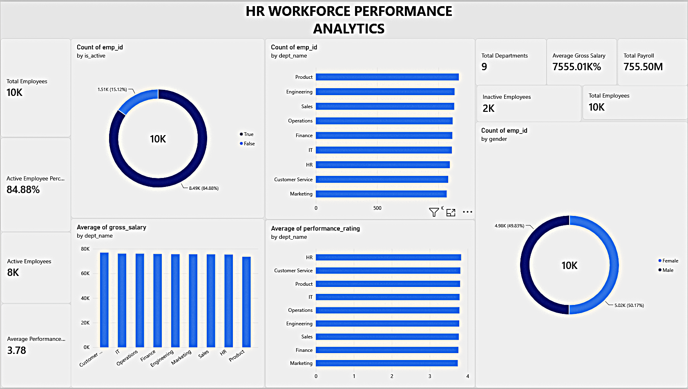
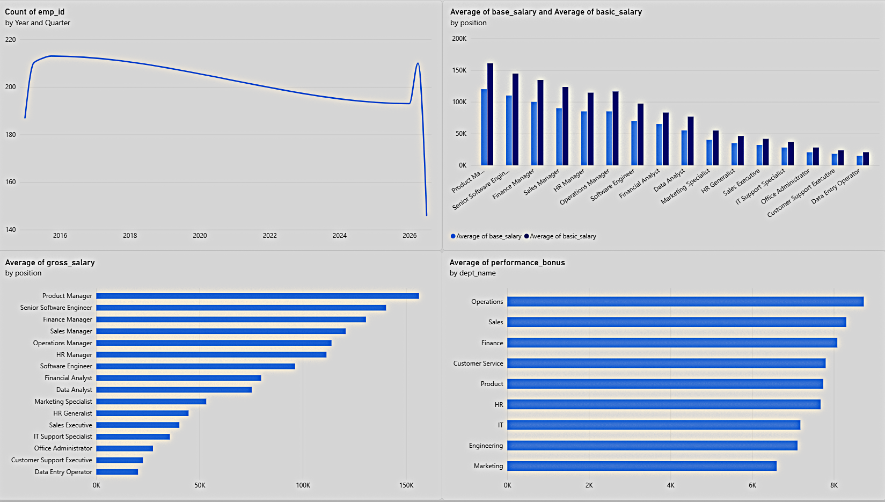
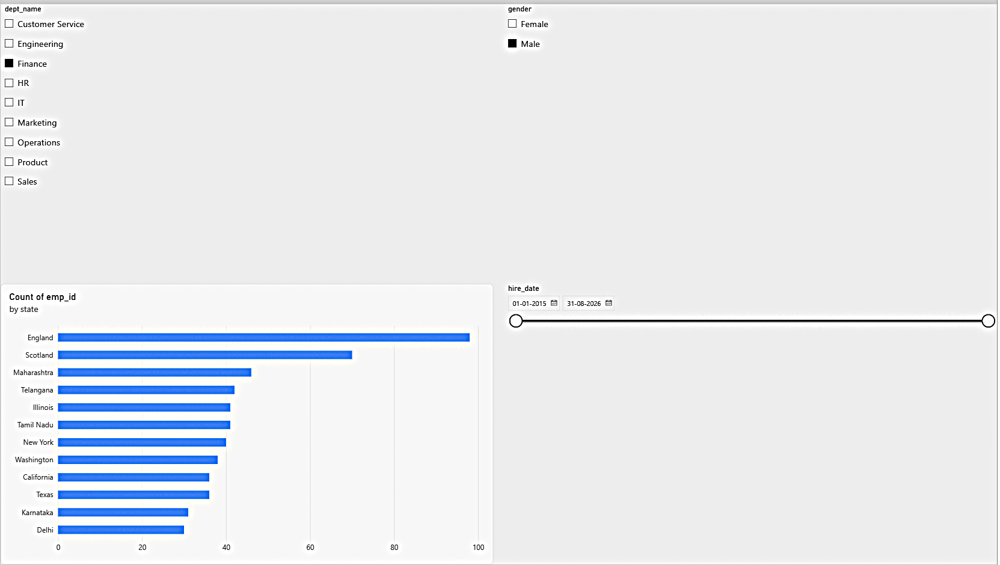

# HR Workforce & Performance Analytics

## Project Overview

HR Workforce & Performance Analytics is a data analytics project designed to analyze employee information, workforce distribution, salary structures, performance ratings, bonuses, and hiring trends.

The project uses Python for data cleaning and analysis, MySQL for database management and SQL queries, and Power BI for interactive data visualization.

## Project Diagrams

### Diagram 1


### Diagram 2


### Diagram 3


## Project Objectives

- Analyze employee demographics and workforce distribution.
- Examine employee status and department-wise headcount.
- Analyze salary structures and job role benchmarks.
- Evaluate employee performance ratings and bonuses.
- Identify hiring trends over time.
- Study salary patterns based on employee experience.
- Build an interactive HR analytics dashboard.
- Generate meaningful business insights.

## Technology Stack

| Technology | Purpose |
|---|---|
| Python | Data cleaning, integration and analysis |
| Pandas | Data manipulation |
| NumPy | Numerical analysis |
| Matplotlib | Data visualization |
| Seaborn | Statistical visualization |
| MySQL 8 | Database management |
| SQL | Workforce analysis and reporting |
| Power BI | Interactive dashboard |
| Git & GitHub | Version control and project hosting |

## Dataset Description

The project uses four CSV datasets:

| Dataset | Description | Records |
|---|---|---:|
| emp_info.csv | Employee personal and demographic information | 10,000 |
| emp_salary.csv | Employee salary and performance information | 10,000 |
| department.csv | Department information | 9 |
| job_roles.csv | Job role and benchmark salary information | 16 |

**Total imported database records: 20,025**

The database contains four tables: employees, salaries, departments and job_roles.

## Project Workflow

### 1. Data Loading and Validation

- Loaded all four CSV datasets using Pandas.
- Checked missing values and duplicate records.
- Validated employee IDs and foreign key references.
- Checked numeric values and date formats.

### 2. Data Cleaning and Integration

- Standardized column names and text values.
- Corrected the performance rating column name.
- Converted date columns into appropriate formats.
- Merged employee, salary, department and job role datasets.
- Created additional features:
  - Full Name
  - Age
  - Years of Service
- Validated gross salary calculations.

Final integrated dataset: **10,000 rows × 28 columns**.

### 3. Exploratory Data Analysis (EDA)

Performed analysis on:

- Employee status distribution
- Gender distribution
- Department-wise employee distribution
- Qualification distribution
- Average salary by department
- Performance ratings by department
- Employee age distribution
- Experience versus salary

### 4. Advanced HR Analysis

Additional analysis includes:

- Employee distribution by city, state and country.
- Marital status distribution.
- Yearly and monthly hiring trends.
- Salary analysis by job role.
- Salary comparison against role benchmarks.
- Performance bonus analysis.
- PF and ESI deduction analysis.
- Performance rating and bonus correlation.
- Statistical summaries and correlation analysis.

The correlation between performance rating and performance bonus was approximately **0.446**, indicating a moderate positive relationship in this dataset.

### 5. MySQL Database

Created the database:

`hr_workforce_analytics`

Database tables:

1. employees
2. salaries
3. departments
4. job_roles

Imported records:

- Employees: 10,000
- Salaries: 10,000
- Departments: 9
- Job Roles: 16

**Total: 20,025 records**

### 6. SQL Analysis

Implemented 17 SQL queries covering:

1. Overall workforce summary
2. Gender distribution
3. Employee count by department
4. Salary analysis by department
5. Performance rating by department
6. Salary analysis by job role
7. Top 10 highest-paid employees
8. Employees above company average salary
9. Experience group analysis
10. Performance rating distribution
11. Department ranking using CTE
12. Salary ranking using window functions
13. Hiring trends by year
14. Employee distribution by location
15. Salary comparison against job role benchmarks
16. Performance bonus by department
17. Experience and salary analysis

SQL concepts used include JOINs, aggregate functions, GROUP BY, CTEs, subqueries, CASE statements, and window functions.

### 7. Power BI Dashboard

Developed an interactive HR Workforce Dashboard using Power BI Desktop.

**KPI Measures**

- Total Employees
- Active Employees
- Inactive Employees
- Average Gross Salary
- Average Performance Rating
- Total Payroll
- Total Departments
- Active Employee Percentage

**Dashboard Visualizations**

1. Employee Status Distribution
2. Employees by Department
3. Average Salary by Department
4. Performance by Department
5. Gender Distribution
6. Hiring Trends by Year
7. Average Salary by Job Role
8. Salary vs Role Benchmark
9. Average Performance Bonus by Department
10. Employee Distribution by State

**Interactive Slicers**

- Department
- Gender
- Hiring Year

## Key Project Findings

| Metric | Result |
|---|---:|
| Total Employees | 10,000 |
| Active Employees | 8,488 |
| Inactive Employees | 1,512 |
| Average Age | 41.27 years |
| Average Experience | 5.92 years |
| Average Gross Salary | 75,550.08 |
| Average Performance Rating | 3.78 |
| Number of Departments | 9 |
| Number of Job Roles | 16 |

Additional findings:

- Product has the highest employee count, with 1,166 employees.
- Customer Service has the highest average salary by department.
- HR has the highest average performance rating by department.
- 2017 has the highest hiring count, with 903 employees.
- Chennai has the highest employee count among the listed cities, with 719 employees.
- Product Manager has the highest average basic salary among the job roles.
- Customer Service has the highest average performance bonus by department.
- Employees with 10 or more years of experience have the highest average gross salary.

## Project Structure

```text
HR-Workforce-Performance-Analytics/
│
├── data/
│   ├── raw/
│   └── processed/
│
├── images/
│   ├── 01_employee_status.png
│   ├── 02_gender_distribution.png
│   ├── 03_department_distribution.png
│   ├── 04_qualification_distribution.png
│   ├── 05_average_salary_by_department.png
│   ├── 06_performance_by_department.png
│   ├── 07_age_distribution.png
│   ├── 08_experience_vs_salary.png
│   ├── 09_correlation_heatmap.png
│   ├── 10_hiring_trends.png
│   ├── 11_salary_by_job_role.png
│   ├── 12_bonus_by_department.png
│   └── 13_employee_distribution_by_state.png
│
├── notebooks/
│
├── powerbi/
│   └── hr_workforce_dashboard.pbix
│
├── reports/
│   ├── eda_summary.txt
│   ├── employee_count_by_department.csv
│   ├── rating_by_department.csv
│   ├── salary_by_department.csv
│   └── [Additional advanced analysis reports]
│
├── sql/
│   └── hr_analysis_queries.sql
│
├── load_datasets.py
├── clean_and_integrate.py
├── eda_analysis.py
├── advanced_hr_analysis.py
├── import_to_mysql.py
├── check_files.py
├── requirements.txt
├── .gitignore
├── LICENSE
└── README.md
```

## Installation and Execution

### 1. Clone the repository

```bash
git clone https://github.com/Arsalan-Dev-Cloud/HR-Workforce-Performance-Analytics.git
cd HR-Workforce-Performance-Analytics
```

### 2. Create a virtual environment

```bash
python -m venv .venv
```

Activate it:

```bash
.venv\Scripts\activate
```

### 3. Install dependencies

```bash
pip install -r requirements.txt
```

### 4. Load and validate datasets

```bash
python load_datasets.py
```

### 5. Clean and integrate datasets

```bash
python clean_and_integrate.py
```

### 6. Perform exploratory analysis

```bash
python eda_analysis.py
```

### 7. Perform advanced analysis

```bash
python advanced_hr_analysis.py
```

### 8. Import datasets into MySQL

Configure your MySQL connection and run:

```bash
python import_to_mysql.py
```

### 9. Execute SQL queries

Open MySQL and execute:

```sql
USE hr_workforce_analytics;

SOURCE E:/HR-Workforce-Performance-Analytics/sql/hr_analysis_queries.sql;
```

### 10. Open the Power BI dashboard

Open:

`powerbi/hr_workforce_dashboard.pbix`

Connect or refresh the MySQL data source if required.

## Limitations

- The project uses the available supplied dataset; findings should not be interpreted as verified real-world HR outcomes.
- The dataset does not contain attendance records or recruitment funnel information.
- Employee satisfaction and engagement data are unavailable.
- Explicit employee resignation and termination event histories are unavailable, so actual attrition rates cannot be calculated.
- Salary benchmark comparisons use the supplied job role benchmark values, not independently verified market salary data.
- Correlation does not establish causation.

## Conclusion

This project demonstrates an end-to-end HR workforce analytics workflow, from data validation and preparation to database management, SQL analysis, statistical exploration and interactive Power BI visualization.

It provides insights into workforce composition, employee demographics, salary structures, performance ratings, bonuses and hiring trends.

The project also demonstrates practical skills in Python, Pandas, MySQL, SQL, Power BI, data analysis and data visualization.

## Author

**Shaikh Mohammad Arsalan Mohsin**

GitHub: [Arsalan-Dev-Cloud](https://github.com/Arsalan-Dev-Cloud)

Project Repository: [HR Workforce Performance Analytics](https://github.com/Arsalan-Dev-Cloud/HR-Workforce-Performance-Analytics)
